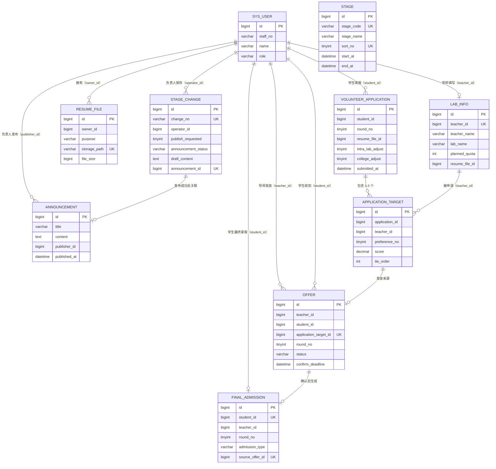

# 实训室选拔系统 · 数据库设计

> 文档状态：设计稿 v1.0  
> 编写日期：2026-11-16  
> 适用数据库：MySQL 8.0+ / InnoDB / utf8mb4 / utf8mb4_0900_ai_ci  
> 依据：`CLAUDE.md`、`docs/requirements/`、`docs/原型图/`  
> 落地文件：本文附录 DDL 可直接落到 `backend/src/main/resources/db/schema.sql`

---

## 1. 设计结论速览

### 1.1 最终表清单（共 10 张）

| # | 表名 | 中文名 | 说明 |
| --- | --- | --- | --- |
| 1 | `sys_user` | 系统用户表 | 身份键为 `(staff_no, role)`，登录时自动创建 |
| 2 | `stage` | 阶段配置表 | 固定 7 行，只允许改起止时间 |
| 3 | `stage_change` | 阶段保存与公告发布记录表 | **新增**，用于保存幂等与公告失败重试 |
| 4 | `announcement` | 公告表 | 只增不改不删，仅阶段保存时生成 |
| 5 | `lab_info` | 导师实训室信息表 | 每个导师一行，不建共享实训室实体 |
| 6 | `resume_file` | 简历文件表 | **新增**，PDF 元数据与归属 |
| 7 | `volunteer_application` | 志愿申请表 | 每生每轮一行 |
| 8 | `application_target` | 志愿目标 / 面试结果表 | 每条志愿对应一个导师目标，含面试分数与同分顺序 |
| 9 | `offer` | 拟录取记录表 | 待确认 / 已确认 / 已放弃 |
| 10 | `final_admission` | 最终录取表 | 每生唯一最终去向，含调剂录取 |

### 1.2 对你给出的 8 张表的调整

| 你的设想 | 本设计 | 调整原因 |
| --- | --- | --- |
| users（用户表） | `sys_user` | 按 `CLAUDE.md` 命名；身份键为 `(学工号, 角色)`，不做账号存在性校验 |
| 公告表 | `announcement` | 保留；只读、只增，新增 `stage_change` 保障发布幂等 |
| 实训室表 | `lab_info` | **按导师一人一行**，不是共享实训室主数据；同一实训室总名额由导师计划人数汇总 |
| 志愿填报表 | `volunteer_application` + `application_target` | 拆成“一轮一份申请”与“一名导师一个目标”，避免在申请表中存重复列 |
| 录取通知表 | `offer` + `final_admission` | 拆成“拟录取记录”与“最终录取”；调剂没有 offer，但必须形成最终录取 |
| 个人待办表 | **不建表** | 需求要求按“当前阶段 + 用户状态”实时推导，落表会产生过期数据 |
| 阶段管理表 | `stage` | 固定 7 行，只更新起止时间，不保留历史版本 |
| 面试结果表 | **并入 `application_target`** | 面试分数天然属于“某学生申请某导师”这一目标，单独建表会重复主键并增加不一致风险 |

### 1.3 需要新增的两张表（请重点确认）

#### `resume_file`（简历文件表）

学生简历和导师简历都需要上传 PDF，并在志愿、实训室信息中引用。文件不能放静态目录，下载必须鉴权，因此需要独立元数据表记录：

- 文件所有者 `owner_id`
- 用途 `STUDENT_RESUME` / `TEACHER_RESUME`
- 磁盘相对路径、原始文件名、大小、MIME
- 下载时的归属与用途校验依据

#### `stage_change`（阶段保存与公告发布记录表）

需求要求：

- 某次阶段保存最多生成一条公告；
- 阶段保存成功但公告发布失败时，阶段仍生效；
- 重试只发布公告，不重复保存阶段、不重复生成公告；
- 重复点击保存只执行一次。

仅靠“前端禁用按钮”不够。`stage_change` 用唯一的 `change_no` 做保存请求幂等键，并保存公告草稿与发布状态，使公告可以在页面刷新后单独重试。

> 如果你不希望增加这张表，替代方案是把草稿和状态塞进 `announcement`，但这会让公告表承担“草稿”职责，与“公告只增不改不删”冲突，不推荐。

### 1.4 不需要建表的业务

- **个人待办**：由阶段、志愿、拟录取、最终录取实时推导，不落表。
- **面试结果**：并入 `application_target.score` / `tie_order`，不单独建表。
- **线上调剂操作**：统筹调剂线下进行，线上只读展示；只写 `final_admission` 结果。
- **登录会话**：使用 HttpSession，不落数据库表。
- **人脸数据、密码、注册**：系统不采集、不存储。

---

## 2. 通用设计约定

### 2.1 数据库与命名

| 项目 | 约定 |
| --- | --- |
| 数据库 | MySQL 8.0+，InnoDB |
| 字符集 | `utf8mb4`，排序规则 `utf8mb4_0900_ai_ci` |
| 表名 | 小写 snake_case，单数形式，如 `sys_user`、`volunteer_application` |
| 字段名 | 小写 snake_case |
| 主键 | `id BIGINT UNSIGNED NOT NULL AUTO_INCREMENT` |
| 外键 | **不建物理外键**，使用逻辑外键 + 索引，完整性在 Service 层保证 |
| 时间字段 | `created_at`、`updated_at` 每表必备 |
| 删除 | 不使用软删除；用状态字段表达放弃 / 失效 |
| 枚举 | `VARCHAR(32)` + Java enum，不使用 MySQL `ENUM` |
| 布尔 | `TINYINT(1)`，0/1 |
| 分数 | `DECIMAL(5,2)`，不使用 `DOUBLE` |
| 名额 | 明确的整型 `INT UNSIGNED` |
| 索引命名 | 唯一索引 `uk_<表简称>_<语义>`，普通索引 `idx_<表简称>_<语义>`，检查约束 `ck_<表简称>_<语义>` |

### 2.2 时间约定

- 所有业务时间使用 **`DATETIME`**，不使用 `TIMESTAMP`，避免数据库时区自动转换。
- 应用与数据库连接统一使用 `Asia/Shanghai`；JDBC 建议配置 `connectionTimeZone=Asia/Shanghai`。
- 业务代码通过可注入的 `Clock` 获取当前时间，禁止散落 `LocalDateTime.now()`。
- 阶段时间精确到分钟，保存时秒位统一归零。
- `offer.confirm_deadline` 是发放时的**快照**，后续调整阶段时间不自动改写。

### 2.3 逻辑外键清单

| 子表.字段 | 父表.字段 | 说明 |
| --- | --- | --- |
| `lab_info.teacher_id` | `sys_user.id` | 必须为 `TEACHER` 身份 |
| `lab_info.resume_file_id` | `resume_file.id` | 必须为本人 `TEACHER_RESUME` |
| `resume_file.owner_id` | `sys_user.id` | 文件所有者 |
| `volunteer_application.student_id` | `sys_user.id` | 必须为 `STUDENT` 身份 |
| `volunteer_application.resume_file_id` | `resume_file.id` | 必须为本人 `STUDENT_RESUME` |
| `application_target.application_id` | `volunteer_application.id` | 所属申请 |
| `application_target.teacher_id` | `sys_user.id` | 必须存在 `lab_info` 记录 |
| `offer.teacher_id` | `sys_user.id` | 发放导师 |
| `offer.student_id` | `sys_user.id` | 被发放学生 |
| `offer.application_target_id` | `application_target.id` | 发放来源，且该目标的 `teacher_id` 必须等于 `offer.teacher_id` |
| `final_admission.student_id` | `sys_user.id` | 每生唯一 |
| `final_admission.teacher_id` | `sys_user.id` | 录取导师 |
| `final_admission.source_offer_id` | `offer.id` | 志愿录取来源；调剂为 NULL |
| `announcement.publisher_id` | `sys_user.id` | 发布负责人 |
| `stage_change.operator_id` | `sys_user.id` | 操作负责人 |
| `stage_change.announcement_id` | `announcement.id` | 发布成功后回填，唯一 |

### 2.4 约束执行层级

| 约束类型 | 执行位置 |
| --- | --- |
| 字段非空、类型、取值范围、唯一性 | 数据库 `NOT NULL` / `CHECK` / `UNIQUE` |
| 状态机、时间窗口、名额、归属、姓名匹配 | Service 层 + 事务 |
| 重复发放、重复确认、重复保存 | 唯一索引 + 事务 + 状态判断三重兜底 |
| 阶段顺序、不重叠、完整性 | Service 层校验后更新 7 行 |

> MySQL 8.0.16 起才真正执行 `CHECK` 约束；更低版本只解析不执行。本项目要求 MySQL 8.0+，建议使用 8.0.16 以上版本。

### 2.5 枚举字典

| 枚举 | 取值 | 使用位置 |
| --- | --- | --- |
| 身份 `role` | `STUDENT` / `TEACHER` / `MANAGER` | `sys_user.role` |
| 阶段编码 `stage_code` | `BRIEFING` / `OPEN_DAY` / `ROUND_1` / `ROUND_2` / `ROUND_3` / `ADJUSTMENT` / `ENROLLMENT` | `stage.stage_code` |
| 公告发布状态 | `NONE` / `PENDING` / `PUBLISHED` / `FAILED` | `stage_change.announcement_status` |
| 简历用途 | `STUDENT_RESUME` / `TEACHER_RESUME` | `resume_file.purpose` |
| 轮次 | `1` / `2` / `3` | `volunteer_application.round_no`、`offer.round_no`、`final_admission.round_no` |
| 拟录取状态 | `PENDING` / `CONFIRMED` / `ABANDONED` | `offer.status` |
| 放弃原因 | `TIMEOUT` / `CONFIRMED_OTHER` | `offer.abandon_reason` |
| 录取类型 | `VOLUNTEER` / `ADJUST_INTRA_LAB` / `ADJUST_COLLEGE` | `final_admission.admission_type` |

> Java 侧统一使用 enum；数据库存 `VARCHAR(32)` 或 `TINYINT`，不使用 MySQL `ENUM`。

---

## 3. ER 图



---

## 4. 表结构详细设计

### 4.1 `sys_user` — 系统用户表

**用途**：保存学生、导师、负责人三类身份。登录时按 `(学工号, 角色)` 自动创建，不校验账号是否存在。

| 字段 | 类型 | 允许 NULL | 默认值 | 约束 / 索引 | 说明 |
| --- | --- | --- | --- | --- | --- |
| `id` | BIGINT UNSIGNED | 否 | AUTO_INCREMENT | PK | 主键，其他表的 `student_id` / `teacher_id` / `publisher_id` 引用此值 |
| `staff_no` | VARCHAR(10) | 否 | — | `uk_staff_no_role` | 学工号，10 位数字；应用层用 `^\d{10}$` 校验 |
| `name` | VARCHAR(64) | 是 | NULL | — | 姓名，可由导入 / 种子数据补充；为空时前端显示学工号 |
| `role` | VARCHAR(32) | 否 | — | `uk_staff_no_role`、`idx_role` | `STUDENT` / `TEACHER` / `MANAGER` |
| `created_at` | DATETIME | 否 | CURRENT_TIMESTAMP | — | 创建时间 |
| `updated_at` | DATETIME | 否 | CURRENT_TIMESTAMP ON UPDATE | — | 更新时间 |

**索引与约束**

- `UNIQUE KEY uk_staff_no_role (staff_no, role)`：身份唯一。同一学工号以两种角色登录会形成两条独立身份。
- `KEY idx_role (role)`：按角色筛选。
- `CHECK role IN ('STUDENT','TEACHER','MANAGER')`。
- 建议增加 `CHECK staff_no REGEXP '^[0-9]{10}$'`；若目标 MySQL 版本对函数型 CHECK 支持不一致，可只在应用层校验。

**业务规则**

1. 首次登录时 `INSERT`；并发首次登录由唯一索引兜底，捕获重复后回查。
2. 不存密码、不存人脸数据、不提供注册和找回密码。
3. 姓名来源为导入 / 种子数据；登录页不要求输入姓名。
4. 会话中保存 `userId, staffNo, name, role`，前端展示信息来自 `GET /auth/me`。
5. 不在本表存“当前是否在线”等会话状态。

---

### 4.2 `stage` — 阶段配置表

**用途**：保存 7 个固定阶段的起止时间。阶段名称、编码、顺序不可增删改。

| 字段 | 类型 | 允许 NULL | 默认值 | 约束 / 索引 | 说明 |
| --- | --- | --- | --- | --- | --- |
| `id` | BIGINT UNSIGNED | 否 | AUTO_INCREMENT | PK | 主键 |
| `stage_code` | VARCHAR(32) | 否 | — | `uk_stage_code` | 固定阶段编码 |
| `stage_name` | VARCHAR(64) | 否 | — | — | 固定阶段名称 |
| `sort_no` | TINYINT UNSIGNED | 否 | — | `uk_stage_sort_no` | 流程顺序 1–7 |
| `start_at` | DATETIME | 是 | NULL | — | 开始时间；未配置时为 NULL |
| `end_at` | DATETIME | 是 | NULL | — | 结束时间；未配置时为 NULL |
| `created_at` | DATETIME | 否 | CURRENT_TIMESTAMP | — | 创建时间 |
| `updated_at` | DATETIME | 否 | CURRENT_TIMESTAMP ON UPDATE | — | 更新时间 |

**固定种子数据（7 行）**

| `sort_no` | `stage_code` | `stage_name` | 说明 |
| --- | --- | --- | --- |
| 1 | `BRIEFING` | 集中宣讲 | 顶层阶段 |
| 2 | `OPEN_DAY` | 实训室开放日 | 顶层阶段 |
| 3 | `ROUND_1` | 第一轮录取 | 顶层“三轮录取”展开 |
| 4 | `ROUND_2` | 第二轮录取 | 顶层“三轮录取”展开 |
| 5 | `ROUND_3` | 第三轮录取 | 顶层“三轮录取”展开 |
| 6 | `ADJUSTMENT` | 统筹调剂 | 顶层阶段 |
| 7 | `ENROLLMENT` | 正式入组 | 顶层阶段 |

**索引与约束**

- `UNIQUE KEY uk_stage_code (stage_code)`。
- `UNIQUE KEY uk_stage_sort_no (sort_no)`。
- `CHECK ((start_at IS NULL AND end_at IS NULL) OR (start_at IS NOT NULL AND end_at IS NOT NULL AND start_at < end_at))`。
  - 允许初始“全部未配置”的空状态。
  - 不允许只填开始或只填结束。

**业务规则**

1. 表内固定 7 行，不提供新增、删除、重命名接口；只更新 `start_at` / `end_at`。
2. 首次配置前 7 行时间均为 NULL，主页面显示“阶段暂未配置”。
3. 保存时 7 行时间必须全部填写；开始早于结束；按 `sort_no` 顺序且不重叠；允许阶段间留空档。
4. 时间精确到分钟，保存时秒位归零。
5. 再次保存更新原 7 行，不新增记录，不保留历史版本。
6. 当前阶段由服务端时间与区间实时计算：落在区间内为当前阶段；落在空档显示下一阶段及开始时间；全部结束后显示“选拔已结束”。
7. 阶段时间调整只影响后续判断，不回滚已放弃的拟录取、不恢复已截止的填报、不改变已提交的志愿和录取结果。
8. `round_no` 与阶段编码映射：`1 → ROUND_1`、`2 → ROUND_2`、`3 → ROUND_3`。
9. “每轮录取”内部不再拆分志愿填报 / 面试 / 确认子阶段，统一使用该轮区间。

---

### 4.3 `stage_change` — 阶段保存与公告发布记录表（新增）

**用途**：为阶段保存提供幂等键，并保存公告草稿与发布状态，使公告失败后可以单独重试。

| 字段 | 类型 | 允许 NULL | 默认值 | 约束 / 索引 | 说明 |
| --- | --- | --- | --- | --- | --- |
| `id` | BIGINT UNSIGNED | 否 | AUTO_INCREMENT | PK | 主键 |
| `change_no` | VARCHAR(64) | 否 | — | `uk_stage_change_change_no` | 保存请求幂等键；建议客户端点击保存时生成 UUID，重试复用 |
| `operator_id` | BIGINT UNSIGNED | 否 | — | — | 操作负责人 `sys_user.id` |
| `publish_requested` | TINYINT(1) | 否 | 0 | — | 本次保存是否请求发布公告 |
| `announcement_status` | VARCHAR(32) | 否 | — | `idx_stage_change_status_created` | `NONE` / `PENDING` / `PUBLISHED` / `FAILED` |
| `draft_title` | VARCHAR(200) | 是 | NULL | — | 公告标题草稿（可编辑后保存） |
| `draft_content` | MEDIUMTEXT | 是 | NULL | — | 公告正文草稿 |
| `announcement_id` | BIGINT UNSIGNED | 是 | NULL | `uk_stage_change_announcement` | 发布成功后的公告 ID |
| `created_at` | DATETIME | 否 | CURRENT_TIMESTAMP | — | 创建时间 |
| `updated_at` | DATETIME | 否 | CURRENT_TIMESTAMP ON UPDATE | — | 更新时间 |

**状态取值**

| 值 | 含义 |
| --- | --- |
| `NONE` | 本次保存不发布公告 |
| `PENDING` | 已保存阶段，公告待发布 / 发布中 |
| `PUBLISHED` | 公告已发布 |
| `FAILED` | 公告发布失败，可重试 |

**索引与约束**

- `UNIQUE KEY uk_stage_change_change_no (change_no)`：同一保存请求只能落一条记录。
- `UNIQUE KEY uk_stage_change_announcement (announcement_id)`：一次阶段保存最多对应一条公告。
- `KEY idx_stage_change_status_created (announcement_status, created_at)`：查询待重试公告。
- `CHECK announcement_status IN ('NONE','PENDING','PUBLISHED','FAILED')`。
- `CHECK ((publish_requested = 0 AND announcement_status = 'NONE') OR (publish_requested = 1 AND announcement_status IN ('PENDING','PUBLISHED','FAILED')))`。
- `CHECK ((publish_requested = 0 AND draft_title IS NULL AND draft_content IS NULL) OR (publish_requested = 1 AND draft_title IS NOT NULL AND draft_content IS NOT NULL))`。
- `CHECK ((announcement_status = 'PUBLISHED' AND announcement_id IS NOT NULL) OR (announcement_status <> 'PUBLISHED' AND announcement_id IS NULL))`。

**业务规则**

1. 阶段保存事务内写入 7 行 `stage` 与该表记录；`change_no` 重复时直接返回已有结果，不重复保存、不重复生成公告。
2. 不发布公告：`publish_requested=0`，`announcement_status='NONE'`，草稿字段为 NULL。
3. 发布公告：阶段保存事务内先保存草稿，状态 `PENDING`；提交后再用**独立事务**发布。
4. 发布成功：插入 `announcement`，回填 `announcement_id`，状态改 `PUBLISHED`。
5. 发布失败：阶段已生效；将状态标记为 `FAILED`，返回 `change_no` 供前端重试。
6. 重试接口只读取该行的草稿并尝试发布，不再次更新 `stage`，不重复生成公告。
7. **本表不是阶段配置历史**：不保存旧时间 / 新时间快照；公告草稿中的文字是公告产物，不是阶段版本。
8. 本表仅负责人可读写，不对外暴露。

---

### 4.4 `announcement` — 公告表

**用途**：保存已发布公告。公告只读、只增，不提供新增、编辑、删除接口。

| 字段 | 类型 | 允许 NULL | 默认值 | 约束 / 索引 | 说明 |
| --- | --- | --- | --- | --- | --- |
| `id` | BIGINT UNSIGNED | 否 | AUTO_INCREMENT | PK | 主键 |
| `title` | VARCHAR(200) | 否 | — | — | 公告标题 |
| `content` | MEDIUMTEXT | 否 | — | — | 公告正文，纯文本，保留换行 |
| `publisher_id` | BIGINT UNSIGNED | 否 | — | `idx_announcement_publisher` | 发布负责人 `sys_user.id` |
| `published_at` | DATETIME | 否 | — | `idx_announcement_published_at` | 发布时间（服务端时间） |
| `created_at` | DATETIME | 否 | CURRENT_TIMESTAMP | — | 创建时间 |
| `updated_at` | DATETIME | 否 | CURRENT_TIMESTAMP ON UPDATE | — | 更新时间 |

**索引与约束**

- `KEY idx_announcement_published_at (published_at, id)`：公告列表按发布时间倒序分页。
- `KEY idx_announcement_publisher (publisher_id)`。

**业务规则**

1. 只能由阶段保存的公告发布流程插入；无单独 CRUD 接口。
2. 发布后不可修改、不可删除。
3. 面向全体登录用户，列表与详情不按角色过滤。
4. 公告摘要由正文派生，不单独存字段。
5. 一次阶段保存最多一条公告，由 `stage_change.uk_stage_change_announcement` 保证。
6. 公告与阶段的关联通过 `stage_change.announcement_id` 反查，不存 `stage_id`（一次公告可能描述多个阶段）。

---

### 4.5 `lab_info` — 导师实训室信息表

**用途**：保存每位导师本人填写的实训室、招生人数、研究方向、联系方式和导师简历。**每个导师一行，不是共享实训室主数据。**

| 字段 | 类型 | 允许 NULL | 默认值 | 约束 / 索引 | 说明 |
| --- | --- | --- | --- | --- | --- |
| `id` | BIGINT UNSIGNED | 否 | AUTO_INCREMENT | PK | 主键 |
| `teacher_id` | BIGINT UNSIGNED | 否 | — | `uk_lab_teacher` | 导师 `sys_user.id`，唯一 |
| `teacher_name` | VARCHAR(64) | 否 | — | `idx_lab_teacher_name` | 导师姓名；保存时去首尾空格、合并连续空格 |
| `lab_name` | VARCHAR(100) | 否 | — | `idx_lab_name` | 实训室名称，由导师自行填写 |
| `location` | VARCHAR(200) | 否 | — | — | 校区、楼栋及房间号 |
| `planned_quota` | INT UNSIGNED | 否 | — | — | 计划招收人数，正整数；跨轮次累计总数 |
| `research_direction` | VARCHAR(200) | 否 | — | `idx_lab_research_direction` | 研究方向 |
| `contact` | VARCHAR(100) | 否 | — | — | 联系方式 |
| `resume_file_id` | BIGINT UNSIGNED | 否 | — | — | 导师简历 `resume_file.id`，用途必须为 `TEACHER_RESUME` |
| `created_at` | DATETIME | 否 | CURRENT_TIMESTAMP | — | 创建时间 |
| `updated_at` | DATETIME | 否 | CURRENT_TIMESTAMP ON UPDATE | — | 更新时间 |

**索引与约束**

- `UNIQUE KEY uk_lab_teacher (teacher_id)`：一名导师只能有一条信息，修改时更新原记录。
- `KEY idx_lab_teacher_name (teacher_name)`：学生提交志愿时按姓名精确匹配。
- `KEY idx_lab_name (lab_name)`、`KEY idx_lab_research_direction (research_direction)`：列表筛选与按实训室汇总。
- `CHECK planned_quota > 0`。

**业务规则**

1. 仅导师本人可写：`WHERE teacher_id = 当前用户 ID`；所有登录用户可读。
2. 不要求负责人预先创建实训室；`lab_name` / `location` 由导师自由填写。
3. 同一实训室的总计划人数 = 该实训室下所有导师 `planned_quota` 之和；通过 `lab_name`（可结合 `location`）分组汇总，本表不存“实训室总额”。
4. 修改 `planned_quota` 时不得小于当前占用名额：
   ```
   占用 = 该导师的 final_admission 数
        + 该导师 status='PENDING' 且未过 confirm_deadline 的 offer 数
   ```
   已过 `confirm_deadline` 但仍为 `PENDING` 的记录按“待超时放弃”处理，不占用新名额；服务端先做惰性校正或计数时排除。
   更新前锁定本行（`SELECT ... FOR UPDATE`），再计数校验。
5. 学生输入导师姓名后，服务端按 `teacher_name` 规范化后精确匹配：
   - 0 条：拒绝，提示“导师姓名不存在或存在重名，请联系负责人”；
   - 多条：拒绝，同一提示；
   - 1 条：解析为 `teacher_id`。
6. `teacher_name` 允许重名（数据库不唯一），重名在提交志愿时拒绝。
7. 简历必须是本人上传的 `TEACHER_RESUME` 文件；导师简历所有登录用户可下载。
8. 不提供删除；信息修改是更新原记录。

> **为什么没有独立的“实训室表”？**  
> 需求明确规定实训室名称和位置由导师自行填写、不要求负责人预先配置，同一实训室计划人数由导师计划人数汇总。若强行建共享 `lab` 表，就必须引入负责人预配置与实训室合并规则，和需求冲突。当前设计把“实训室”作为 `lab_info` 上的展示属性。

---

### 4.6 `resume_file` — 简历文件表（新增）

**用途**：保存 PDF 简历的元数据与所有者，供鉴权下载和引用校验。文件本体存放在 Web 根目录之外。

| 字段 | 类型 | 允许 NULL | 默认值 | 约束 / 索引 | 说明 |
| --- | --- | --- | --- | --- | --- |
| `id` | BIGINT UNSIGNED | 否 | AUTO_INCREMENT | PK | 主键，即接口返回的 `fileId` |
| `owner_id` | BIGINT UNSIGNED | 否 | — | `idx_resume_owner_purpose` | 上传者 `sys_user.id` |
| `purpose` | VARCHAR(32) | 否 | — | `idx_resume_owner_purpose` | `STUDENT_RESUME` / `TEACHER_RESUME` |
| `original_name` | VARCHAR(255) | 否 | — | — | 用户原始文件名，仅用于下载展示 |
| `storage_path` | VARCHAR(255) | 否 | — | `uk_resume_storage_path` | 相对上传根目录的路径，如 `2026/11/{uuid}.pdf` |
| `content_type` | VARCHAR(100) | 否 | — | — | 固定为 `application/pdf` |
| `file_size` | BIGINT UNSIGNED | 否 | — | — | 字节数 |
| `created_at` | DATETIME | 否 | CURRENT_TIMESTAMP | — | 上传/创建时间 |
| `updated_at` | DATETIME | 否 | CURRENT_TIMESTAMP ON UPDATE | — | 更新时间 |

**索引与约束**

- `UNIQUE KEY uk_resume_storage_path (storage_path)`：防止磁盘路径重复。
- `KEY idx_resume_owner_purpose (owner_id, purpose)`：校验“某用户的某用途文件”。
- `CHECK purpose IN ('STUDENT_RESUME','TEACHER_RESUME')`。
- `CHECK file_size > 0`。

**业务规则**

1. 只接受 PDF：扩展名 `.pdf`、`Content-Type: application/pdf`、文件头 `%PDF-`；大小默认上限 10 MB。
2. 磁盘文件名使用 UUID，禁止使用原始文件名；`storage_path` 存相对路径，防止路径穿越。
3. 不把 `uploads/` 映射为静态资源；下载统一走 `GET /files/{id}`，在 Service 校验会话与归属。
4. 上传接口返回 `fileId`；提交志愿/实训室信息时只传 `fileId`，服务端校验文件属于当前用户且用途匹配。
5. 访问规则：
   - `TEACHER_RESUME`：所有已登录用户可读；
   - `STUDENT_RESUME`：仅学生本人，以及收到该学生申请的导师可读（通过 `application_target.teacher_id = 当前用户` 判断）。
6. 替换简历时更新引用（`volunteer_application.resume_file_id` / `lab_info.resume_file_id`），旧文件保留；孤立文件清理后置，不在请求链路中删除。
7. 上传失败不产生半条数据库记录。

---

### 4.7 `volunteer_application` — 志愿申请表

**用途**：保存学生每轮的一次志愿申请，包括简历与两项调剂意愿。每生每轮一行。

| 字段 | 类型 | 允许 NULL | 默认值 | 约束 / 索引 | 说明 |
| --- | --- | --- | --- | --- | --- |
| `id` | BIGINT UNSIGNED | 否 | AUTO_INCREMENT | PK | 主键 |
| `student_id` | BIGINT UNSIGNED | 否 | — | `uk_va_student_round` | 学生 `sys_user.id` |
| `round_no` | TINYINT UNSIGNED | 否 | — | `uk_va_student_round`、`idx_va_round` | 轮次 1 / 2 / 3 |
| `resume_file_id` | BIGINT UNSIGNED | 否 | — | — | 学生简历，必须为本人 `STUDENT_RESUME` |
| `intra_lab_adjust` | TINYINT(1) | 否 | — | — | 是否同意实训室内调剂 |
| `college_adjust` | TINYINT(1) | 否 | — | — | 是否同意学院内调剂 |
| `submitted_at` | DATETIME | 否 | — | `idx_va_student_submitted` | 最后一次成功提交时间（服务端时间） |
| `created_at` | DATETIME | 否 | CURRENT_TIMESTAMP | — | 创建时间 |
| `updated_at` | DATETIME | 否 | CURRENT_TIMESTAMP ON UPDATE | — | 更新时间 |

**索引与约束**

- `UNIQUE KEY uk_va_student_round (student_id, round_no)`：每生每轮一条。
- `KEY idx_va_round (round_no)`：按轮次统计/查询。
- `KEY idx_va_student_submitted (student_id, submitted_at)`：查询学生最后一次成功提交。
- `CHECK round_no BETWEEN 1 AND 3`。
- `CHECK intra_lab_adjust IN (0,1) AND college_adjust IN (0,1)`。

**业务规则**

1. 第一、二、三轮各保存一份，互不覆盖。
2. 同一轮再次提交时更新本行 `submitted_at`，并替换该申请的 `application_target`；不新增第二条申请。替换前锁定该申请行（`SELECT ... FOR UPDATE`），避免并发重填交错。
3. 只在对应轮次时间内提交；已存在最终录取的学生不可提交；补录轮次所填导师必须仍有剩余名额。
4. 两项调剂意愿必选，均可为“不同意”；不同意不影响正常提交。
5. 志愿导师 1–3 名，平行志愿；至少 1 名；不可重复；仅空格视为未填写。
6. `submitted_at` 用于“最后一次成功提交的调剂意愿”：按 `submitted_at DESC, round_no DESC` 取第一条。
7. 仅学生本人可读写；导师只能通过 `application_target.teacher_id` 看到投递到本人的申请。
8. 已进入评分/发放阶段的轮次，建议禁止学生再次重填（见 §9 待确认问题）；否则替换 `application_target` 会影响已有分数和 offer 引用。

---

### 4.8 `application_target` — 志愿目标 / 面试结果表

**用途**：把一次志愿申请解析为 1–3 个导师目标，并保存该目标的面试分数与同分顺序。**这就是“面试结果”的落点，不再单独建面试结果表。**

| 字段 | 类型 | 允许 NULL | 默认值 | 约束 / 索引 | 说明 |
| --- | --- | --- | --- | --- | --- |
| `id` | BIGINT UNSIGNED | 否 | AUTO_INCREMENT | PK | 主键 |
| `application_id` | BIGINT UNSIGNED | 否 | — | `uk_at_application_teacher`、`uk_at_application_pref` | 所属 `volunteer_application.id` |
| `teacher_id` | BIGINT UNSIGNED | 否 | — | `uk_at_application_teacher`、`idx_at_teacher`、`idx_at_teacher_score` | 解析后的导师 `sys_user.id`，必须存在 `lab_info` |
| `preference_no` | TINYINT UNSIGNED | 否 | — | `uk_at_application_pref` | 输入框序号 1–3；仅用于展示，志愿平行 |
| `score` | DECIMAL(5,2) | 是 | NULL | `idx_at_teacher_score` | 面试分数 0–100；NULL 表示未评分 |
| `tie_order` | INT UNSIGNED | 是 | NULL | — | 同分学生手动顺序，越小越靠前 |
| `scored_at` | DATETIME | 是 | NULL | — | 最近评分时间 |
| `created_at` | DATETIME | 否 | CURRENT_TIMESTAMP | — | 创建时间 |
| `updated_at` | DATETIME | 否 | CURRENT_TIMESTAMP ON UPDATE | — | 更新时间 |

**索引与约束**

- `UNIQUE KEY uk_at_application_teacher (application_id, teacher_id)`：同一轮同一导师只能出现一次。
- `UNIQUE KEY uk_at_application_pref (application_id, preference_no)`：一个输入框只对应一个目标。
- `KEY idx_at_teacher (teacher_id)`：导师查看本人名下申请。
- `KEY idx_at_teacher_score (teacher_id, score)`：按分数排序/筛选。
- `CHECK preference_no BETWEEN 1 AND 3`。
- `CHECK score IS NULL OR (score >= 0 AND score <= 100)`。

**业务规则**

1. 学生输入导师姓名，服务端用 `lab_info.teacher_name` 规范化后精确匹配；未匹配或重名则整单拒绝，不生成目标。
2. `preference_no` 保留输入框位置，便于前端展示“第 1/2/3 志愿”；三个志愿平行，不区分优先级。
3. 同一申请内导师不可重复，唯一索引兜底。
4. `score` 由导师录入；未评分不参与发放。分数可修改，修改时更新 `scored_at`。
5. 同分学生由导师手动确定顺序，写入 `tie_order`；同一分数组内未定序时，不向该组发放。
6. 发放排序：`score DESC, tie_order ASC, id ASC`；未评分排除。
7. 导师只能访问 `teacher_id = 当前用户 ID` 的目标；学生只能访问本人申请下的目标。
8. 导师查看学生简历的授权路径：`application_target.teacher_id = 当前用户` → `volunteer_application.resume_file_id`。
9. 不单独建 `interview_result` 表：面试分数的主键语义就是 `(application_id, teacher_id)`，单独建表会产生重复键和两处不一致风险。

---

### 4.9 `offer` — 拟录取记录表

**用途**：保存导师发放的拟录取记录及其确认状态。状态只能单向流转。

| 字段 | 类型 | 允许 NULL | 默认值 | 约束 / 索引 | 说明 |
| --- | --- | --- | --- | --- | --- |
| `id` | BIGINT UNSIGNED | 否 | AUTO_INCREMENT | PK | 主键 |
| `teacher_id` | BIGINT UNSIGNED | 否 | — | `uk_offer_teacher_round_student`、`idx_offer_teacher_round_status`、`idx_offer_teacher_status` | 发放导师 `sys_user.id` |
| `student_id` | BIGINT UNSIGNED | 否 | — | `uk_offer_teacher_round_student`、`idx_offer_student_round`、`idx_offer_student_status` | 学生 `sys_user.id` |
| `application_target_id` | BIGINT UNSIGNED | 否 | — | `uk_offer_application_target` | 来源 `application_target.id`，一个目标最多一条拟录取 |
| `round_no` | TINYINT UNSIGNED | 否 | — | `uk_offer_teacher_round_student`、`idx_offer_teacher_round_status` | 轮次 1 / 2 / 3 |
| `status` | VARCHAR(32) | 否 | — | `idx_offer_student_status`、`idx_offer_teacher_round_status`、`idx_offer_teacher_status`、`idx_offer_status_deadline` | `PENDING` / `CONFIRMED` / `ABANDONED` |
| `confirm_deadline` | DATETIME | 否 | — | `idx_offer_status_deadline` | 确认截止时间；发放时写入本轮结束时间，后续不自动改写 |
| `granted_at` | DATETIME | 否 | — | — | 发放时间 |
| `confirmed_at` | DATETIME | 是 | NULL | — | 确认时间 |
| `abandoned_at` | DATETIME | 是 | NULL | — | 放弃时间 |
| `abandon_reason` | VARCHAR(32) | 是 | NULL | — | `TIMEOUT` / `CONFIRMED_OTHER` |
| `created_at` | DATETIME | 否 | CURRENT_TIMESTAMP | — | 创建时间 |
| `updated_at` | DATETIME | 否 | CURRENT_TIMESTAMP ON UPDATE | — | 更新时间 |

**索引与约束**

- `UNIQUE KEY uk_offer_teacher_round_student (teacher_id, round_no, student_id)`：同一导师同一轮不向同一学生重复发放。
- `UNIQUE KEY uk_offer_application_target (application_target_id)`：一个志愿目标最多一条拟录取。
- `KEY idx_offer_student_round (student_id, round_no)`：学生查看本人拟录取。
- `KEY idx_offer_student_status (student_id, status)`：确认时锁定本人所有待确认记录。
- `KEY idx_offer_teacher_round_status (teacher_id, round_no, status)`：导师按轮次查看名额占用。
- `KEY idx_offer_teacher_status (teacher_id, status)`：跨轮次计算导师占用名额。
- `KEY idx_offer_status_deadline (status, confirm_deadline)`：超时放弃定时任务。
- `CHECK round_no BETWEEN 1 AND 3`。
- `CHECK status IN ('PENDING','CONFIRMED','ABANDONED')`。
- `CHECK abandon_reason IS NULL OR abandon_reason IN ('TIMEOUT','CONFIRMED_OTHER')`。
- `CHECK ((status = 'PENDING' AND confirmed_at IS NULL AND abandoned_at IS NULL AND abandon_reason IS NULL) OR (status = 'CONFIRMED' AND confirmed_at IS NOT NULL AND abandoned_at IS NULL AND abandon_reason IS NULL) OR (status = 'ABANDONED' AND confirmed_at IS NULL AND abandoned_at IS NOT NULL AND abandon_reason IS NOT NULL))`。

**状态机**

```
PENDING ──确认──> CONFIRMED
   │
   └──超时 / 确认其他──> ABANDONED
```

- 只允许 `PENDING → CONFIRMED` 或 `PENDING → ABANDONED`。
- 终态不可回退；阶段调整不触发回滚。

**业务规则**

1. 由导师发放生成，初始 `PENDING`；`confirm_deadline` 取发放时本轮 `stage.end_at`。
2. 待确认（`PENDING`）与已确认（`CONFIRMED`）都占用导师名额；`ABANDONED` 释放名额。
3. 学生确认：
   - 只能确认本人、`PENDING`、且未到 `confirm_deadline` 的记录；
   - 确认一条后，其余本人 `PENDING` 记录全部改 `ABANDONED`，原因 `CONFIRMED_OTHER`；
   - 同时插入 `final_admission`（志愿录取）；
   - 并发/重复确认由 `final_admission.uk_fa_student` 与事务兜底。
4. 超时放弃：
   - 定时任务将 `status='PENDING' AND confirm_deadline <= 当前时间` 的记录改为 `ABANDONED`，原因 `TIMEOUT`；
   - 读取 / 确认时再做惰性校正；
   - 已确认记录不受影响。
5. 导师只能查看和处理 `teacher_id = 当前用户 ID` 的记录。
6. 已有 `final_admission` 的学生不再接收新拟录取。
7. 发放截止后不再新增或递补。
8. 不存短信、邮件、站内推送状态；系统内生成记录即视为“发放”。

---

### 4.10 `final_admission` — 最终录取表

**用途**：保存每名学生唯一的最终录取去向，区分志愿录取与统筹调剂录取。

| 字段 | 类型 | 允许 NULL | 默认值 | 约束 / 索引 | 说明 |
| --- | --- | --- | --- | --- | --- |
| `id` | BIGINT UNSIGNED | 否 | AUTO_INCREMENT | PK | 主键 |
| `student_id` | BIGINT UNSIGNED | 否 | — | `uk_fa_student` | 学生 `sys_user.id`，全表唯一 |
| `teacher_id` | BIGINT UNSIGNED | 否 | — | `idx_fa_teacher` | 录取导师 `sys_user.id` |
| `round_no` | TINYINT UNSIGNED | 是 | NULL | — | 志愿录取轮次 1–3；调剂为 NULL |
| `admission_type` | VARCHAR(32) | 否 | — | `idx_fa_type` | `VOLUNTEER` / `ADJUST_INTRA_LAB` / `ADJUST_COLLEGE` |
| `source_offer_id` | BIGINT UNSIGNED | 是 | NULL | `uk_fa_source_offer` | 志愿录取来源 `offer.id`；调剂为 NULL |
| `admitted_at` | DATETIME | 否 | — | — | 录取形成时间（确认时间或调剂导入时间） |
| `created_at` | DATETIME | 否 | CURRENT_TIMESTAMP | — | 创建时间 |
| `updated_at` | DATETIME | 否 | CURRENT_TIMESTAMP ON UPDATE | — | 更新时间 |

**索引与约束**

- `UNIQUE KEY uk_fa_student (student_id)`：每名学生最终只能有一个去向。
- `UNIQUE KEY uk_fa_source_offer (source_offer_id)`：一条拟录取最多生成一条最终录取。
- `KEY idx_fa_teacher (teacher_id)`：计算导师占用名额。
- `KEY idx_fa_type (admission_type)`：区分志愿/调剂统计。
- `CHECK admission_type IN ('VOLUNTEER','ADJUST_INTRA_LAB','ADJUST_COLLEGE')`。
- `CHECK ((admission_type = 'VOLUNTEER' AND round_no IS NOT NULL AND round_no BETWEEN 1 AND 3 AND source_offer_id IS NOT NULL) OR (admission_type IN ('ADJUST_INTRA_LAB','ADJUST_COLLEGE') AND round_no IS NULL AND source_offer_id IS NULL))`。

**业务规则**

1. 志愿录取：学生确认 `offer` 时在同一事务插入，`admission_type='VOLUNTEER'`，`round_no` 取 offer 轮次，`source_offer_id` 取该 offer。
2. 调剂录取：三轮结束后由线下确定，通过脚本/初始化导入，`admission_type` 为 `ADJUST_INTRA_LAB` 或 `ADJUST_COLLEGE`，`round_no` 与 `source_offer_id` 为 NULL。
3. 调剂不要求学生确认，线上只读展示。
4. 每名学生只能有一条记录；唯一索引是“最终只有一个去向”的最后防线。
5. 最终录取占用导师名额，计算方式见 §5.1。
6. 已有最终录取的学生：不能提交志愿、不能进入补录、不能被发放新拟录取；主页面显示“已录取”。
7. 不设状态字段，不提供回滚/撤销接口。
8. 按数据权限矩阵，学生只读本人，导师只读本人发放形成的记录，负责人不可访问。

---

## 5. 关键业务规则的数据库落地

### 5.1 名额计算（核心）

**口径**：`lab_info.planned_quota` 是该导师三轮累计的计划招收总数，不是每轮独立名额。  
**占用** = 该导师已形成的最终录取 + 该导师当前待确认的拟录取。

```sql
-- 某导师当前占用名额
SELECT
    (SELECT COUNT(*)
       FROM final_admission fa
      WHERE fa.teacher_id = #{teacherId}) AS admitted_count,
    (SELECT COUNT(*)
       FROM offer o
      WHERE o.teacher_id = #{teacherId}
        AND o.status = 'PENDING'
        AND o.confirm_deadline > #{now}) AS pending_count;
```

```
占用名额 = admitted_count + pending_count
剩余名额 = planned_quota - 占用名额
```

**为什么这样算**

- `final_admission` 已覆盖：
  - 学生确认的志愿拟录取（`CONFIRMED` offer 已转成最终录取）；
  - 三轮后的实训室内 / 学院内调剂录取。
- `PENDING` 且未过 `confirm_deadline` 的 offer 是“已发放但学生尚未确认”的预留名额。
- `ABANDONED` offer 释放名额，教师可在截止前递补。
- 不能直接用 `offer.status IN ('PENDING','CONFIRMED')` 算总数，否则会与调剂录取漏算或与最终录取重复计算。

**并发控制**

1. 发放 / 递补 / 调剂导入前，对 `lab_info` 对应行执行 `SELECT ... FOR UPDATE`，把同一导师的名额操作串行化。
2. 锁内重新计算占用与剩余名额。
3. 插入 `offer` / `final_admission` 后提交事务。
4. 唯一索引作为最后防线：
   - `offer(teacher_id, round_no, student_id)` 防重复发放；
   - `offer(application_target_id)` 防同一目标重复发放；
   - `final_admission(student_id)` 防一人多去向。
5. 不把“已占用名额”冗余存进 `lab_info`，避免计数漂移；需要时实时计算。

### 5.2 发放拟录取的事务流程

1. 校验当前用户为导师、当前处于对应轮次、未过发放截止。
2. `SELECT * FROM lab_info WHERE teacher_id = ? FOR UPDATE`（锁定名额）。
3. 计算占用与剩余名额；剩余为 0，返回“名额已满”。
4. 查询本人本轮申请目标：
   - `score IS NOT NULL`；
   - `score >= 录取分数线`；
   - 学生无 `final_admission`；
   - 该目标无 `offer`；
   - 同分组的 `tie_order` 已确定。
5. 按 `score DESC, tie_order ASC, id ASC` 排序，依次插入 `offer`：
   - `status='PENDING'`；
   - `granted_at=当前时间`；
   - `confirm_deadline=本轮 stage.end_at`；
   - 直到名额占满或没有达标学生。
6. 提交事务。
7. 重复点击 / 并发请求由事务 + 唯一索引保证不超发、不重复。

### 5.3 拟录取确认的事务流程

1. 锁定该学生所有 `PENDING` offer（`SELECT ... FOR UPDATE`）。
2. 校验目标 offer：
   - 属于当前学生；
   - `status='PENDING'`；
   - 当前时间 `< confirm_deadline`；
   - 学生无 `final_admission`。
3. 目标 offer 改 `CONFIRMED`，写 `confirmed_at`。
4. 其余 `PENDING` offer 改 `ABANDONED`，写 `abandoned_at`、`abandon_reason='CONFIRMED_OTHER'`。
5. 插入 `final_admission`：
   - `student_id`、`teacher_id`、`round_no` 来自目标 offer；
   - `admission_type='VOLUNTEER'`；
   - `source_offer_id=目标 offer.id`；
   - `admitted_at=当前时间`。
6. 提交。
7. `final_admission.uk_fa_student` 兜底并发重复确认；冲突时回滚并返回“已确认录取，不可更改”。

### 5.4 超时自动放弃

```sql
UPDATE offer
   SET status = 'ABANDONED',
       abandoned_at = #{now},
       abandon_reason = 'TIMEOUT'
 WHERE status = 'PENDING'
   AND confirm_deadline <= #{now};
```

- 定时任务执行；读取 / 确认前也做惰性校正。
- `idx_offer_status_deadline (status, confirm_deadline)` 支撑。
- 只更新 `PENDING`，已确认记录不受影响。
- 阶段时间调整不修改 `confirm_deadline`，因此不会“复活”或延长已发出的拟录取。

### 5.5 阶段保存与公告发布流程

**保存阶段（以发布公告为例）**

1. 客户端为本次点击生成 `change_no`（UUID），重试复用。
2. 服务端校验：7 个阶段时间完整、开始早于结束、顺序正确、不重叠、公告标题/正文非空。
3. 事务 A：
   - 更新 `stage` 7 行；
   - 插入 `stage_change`：`change_no`、`operator_id`、`publish_requested=1`、`announcement_status='PENDING'`、草稿标题/正文。
4. 提交事务 A，阶段立即生效。
5. 事务 B（发布公告）：
   - `SELECT stage_change ... FOR UPDATE`；
   - 若已 `PUBLISHED`，直接返回已有公告（幂等）；
   - 插入 `announcement`；
   - 回填 `announcement_id`，状态改 `PUBLISHED`。
6. 事务 B 失败：回滚公告插入，另起短事务把状态标 `FAILED`；返回 `change_no` 与失败提示。
7. 重试接口 `POST /manager/stages/announcement`：
   - 按 `change_no` 读取草稿；
   - 只执行事务 B；
   - 不更新 `stage`，不新增 `stage_change`，不重复生成公告。
8. `change_no` 重复的保存请求：直接返回该记录已有结果，不重复保存阶段、不重复发布。

**不发布公告**

- 事务 A 中 `publish_requested=0`、`announcement_status='NONE'`，不写草稿，不进入事务 B。
- 阶段立即生效，公告列表不新增记录。

### 5.6 统筹调剂结果的落库

- 三轮结束后，线下确定调剂结果。
- 通过脚本 / 初始化导入 `final_admission`：
  - `admission_type='ADJUST_INTRA_LAB'` 或 `'ADJUST_COLLEGE'`；
  - `round_no=NULL`、`source_offer_id=NULL`；
  - `admitted_at` 为导入时间。
- 导入前校验：
  - 学生无 `final_admission`；
  - 学生无 `PENDING` / `CONFIRMED` offer（或将遗留 `PENDING` 按超时处理）；
  - 导师剩余名额充足；
  - 不突破 `planned_quota`。
- 每批导入使用事务；`uk_fa_student` 防重复；必要时锁定 `lab_info` 行。
- 不实现线上调剂确认、导师接收页面。

### 5.7 并发点与兜底汇总

| 场景 | 事务 / 锁 | 唯一索引兜底 |
| --- | --- | --- |
| 首次登录并发建用户 | `INSERT` 捕获重复后回查 | `sys_user(staff_no, role)` |
| 导师首次保存 / 修改实训室信息 | 锁定 `lab_info` 行 | `lab_info(teacher_id)` |
| 同轮重复提交志愿 | 锁定该生该轮申请行后替换目标 | `volunteer_application(student_id, round_no)`、`application_target(application_id, teacher_id)` |
| 重复录入同分顺序 | 事务内更新 | 同上 |
| 并发发放 / 递补 | 锁定 `lab_info` 行 | `offer(teacher_id, round_no, student_id)`、`offer(application_target_id)` |
| 并发 / 重复确认 | 锁定学生 `PENDING` offer | `final_admission(student_id)`、`offer(application_target_id)` |
| 超时任务与确认并发 | 双方都带 `status='PENDING'` 条件 | 状态条件 + 唯一索引 |
| 重复保存阶段 | 按 `sort_no` 顺序锁定/更新 7 行；`stage_change.change_no` 幂等 | `uk_stage_change_change_no` |
| 重复发布公告 | 锁定 `stage_change` 行 | `uk_stage_change_announcement` |
| 调剂重复导入 | 事务 + 锁名额 | `final_admission(student_id)` |

### 5.8 个人待办的推导（不落表）

个人待办不建表，由“当前阶段 + 用户状态”实时查询推导。推荐规则如下：

| 角色 | 待办 | 推导条件 | 截止时间 |
| --- | --- | --- | --- |
| 学生 | 填报志愿 / 补录填报 | 当前处于某轮；无 `final_admission`；该轮无 `volunteer_application`；补录还要求存在剩余名额导师 | 该轮 `stage.end_at` |
| 学生 | 确认拟录取 | 无 `final_admission`；存在 `status='PENDING'` 且未过 `confirm_deadline` 的 offer | 最早一条 `confirm_deadline` |
| 学生 | 无待办 | 已有 `final_admission`；或当前阶段无可办理事项 | — |
| 导师 | 填写 / 修改实训室信息 | 当前用户无 `lab_info`，或当前处于需要展示信息的阶段 | 按页面约定；无强制截止时可为空 |
| 导师 | 录入面试分数 | 当前处于某轮；本人名下有未评分目标 | 该轮 `stage.end_at` |
| 导师 | 发放拟录取 | 当前处于某轮；存在已评分且达标的目标；剩余名额 > 0；未过该轮结束时间 | 该轮 `stage.end_at` |
| 负责人 | 配置 / 调整阶段 | 7 个阶段存在未配置，或当前处于可调整阶段 | 无（由负责人自行安排） |

**要求**

- 已完成、已截止、已放弃的事项不再展示。
- 加载失败必须返回失败态，前端显示“加载失败，请重试”，不能当作“暂无待办”。
- 待办只做查询推导，不缓存过期结果；如后续性能需要缓存，必须有明确的失效策略，不能把缓存当作事实来源。

---

## 6. 数据权限与查询约束

| 表 / 数据 | 学生 | 导师 | 负责人 | 查询必须带的条件 |
| --- | --- | --- | --- | --- |
| `sys_user` | 本人 | 本人 | 本人 | 会话中的 `userId`，不接受请求参数传入的身份 |
| `stage` | 只读 | 只读 | 读写 | 无个人条件；写接口仅负责人 |
| `announcement` | 只读 | 只读 | 只读 | 无个人条件；无写接口 |
| `stage_change` | 不可访问 | 不可访问 | 读写 | 仅负责人；按 `change_no` 操作 |
| `lab_info` | 只读全部 | 只读全部，仅改本人 | 只读 | 写：`teacher_id = 当前用户 ID` |
| `resume_file` | 本人学生简历 | 本人导师简历 + 投递到本人的学生简历 | 只读（按需） | 学生简历：`owner_id = 当前用户` 或存在 `application_target.teacher_id = 当前用户` |
| `volunteer_application` | 读写本人 | 仅通过目标访问 | 不可访问 | 学生：`student_id = 当前用户 ID` |
| `application_target` | 本人申请下 | 仅本人名下 | 不可访问 | 导师：`teacher_id = 当前用户 ID` |
| `offer` | 只读本人 | 仅本人发放 | 不可访问 | 学生：`student_id = 当前用户 ID`；导师：`teacher_id = 当前用户 ID` |
| `final_admission` | 只读本人 | 仅本人发放 | 不可访问 | 学生：`student_id = 当前用户 ID`；导师：`teacher_id = 当前用户 ID` |

**硬性要求**

- 任何个人记录查询的 SQL 必须带当前会话用户条件，例如：
  - `WHERE student_id = #{currentUserId}`
  - `WHERE teacher_id = #{currentUserId}`
- 通过 URL / 请求体传入的资源 ID，先查归属再操作。
- 越权返回 HTTP 403 + `code=40301`，不能返回“操作成功”空结果。
- 文件下载同样校验归属与用途。
- 负责人按矩阵不可访问录取明细；若业务需要全局查看，需先修改权限矩阵。

---

## 7. 索引设计汇总

| 表 | 索引 | 主要用途 |
| --- | --- | --- |
| `sys_user` | `uk_staff_no_role`、`idx_role` | 登录查身份、按角色统计 |
| `stage` | `uk_stage_code`、`uk_stage_sort_no` | 固定阶段编码/顺序 |
| `stage_change` | `uk_change_no`、`uk_announcement`、`idx_status_created` | 保存幂等、公告去重、待重试查询 |
| `announcement` | `idx_published_at`、`idx_publisher` | 公告列表分页、按发布人查询 |
| `resume_file` | `uk_storage_path`、`idx_owner_purpose` | 路径唯一、文件归属/用途校验 |
| `lab_info` | `uk_teacher`、`idx_teacher_name`、`idx_lab_name`、`idx_research_direction` | 导师唯一、姓名匹配、列表筛选 |
| `volunteer_application` | `uk_student_round`、`idx_round`、`idx_student_submitted` | 每生每轮唯一、按轮次统计、最后一次提交 |
| `application_target` | `uk_application_teacher`、`uk_application_pref`、`idx_teacher`、`idx_teacher_score` | 防重复导师、展示序号、导师查申请、按分数排序 |
| `offer` | `uk_teacher_round_student`、`uk_application_target`、`idx_student_round`、`idx_student_status`、`idx_teacher_round_status`、`idx_teacher_status`、`idx_status_deadline` | 防重复发放、学生/导师查询、名额统计、超时扫描 |
| `final_admission` | `uk_student`、`uk_source_offer`、`idx_teacher`、`idx_type` | 一人一去向、来源唯一、名额统计、类型统计 |

**说明**

- 本系统数据量不大，索引以“唯一约束 + 高频查询”为主；上线前用 `EXPLAIN` 复核。
- 实训室关键字搜索是 `LIKE '%关键字%'`，B-Tree 索引无法覆盖前置通配符；数据量小可接受，后续如需要可加全文索引或搜索引擎。
- 不引入 PageHelper；分页统一 `LIMIT #{offset}, #{size}` + 独立 count 查询。

---

## 8. 初始化数据

### 8.1 阶段固定 7 行（必须）

```sql
INSERT INTO stage (stage_code, stage_name, sort_no, start_at, end_at) VALUES
('BRIEFING',   '集中宣讲',     1, NULL, NULL),
('OPEN_DAY',   '实训室开放日', 2, NULL, NULL),
('ROUND_1',    '第一轮录取',   3, NULL, NULL),
('ROUND_2',    '第二轮录取',   4, NULL, NULL),
('ROUND_3',    '第三轮录取',   5, NULL, NULL),
('ADJUSTMENT', '统筹调剂',     6, NULL, NULL),
('ENROLLMENT', '正式入组',     7, NULL, NULL);
```

### 8.2 生产与开发数据

- 生产环境：只初始化 `stage` 7 行；不灌入演示用户、公告、志愿、拟录取。
- 开发环境：可在 `db/data.sql` 中加入演示用户、实训室信息、志愿等，但必须保证：
  - 不包含真实学生个人信息；
  - 不在生产自动执行；
  - 不把演示数据写进正式页面代码。
- `sys_user.name` 可由种子数据或导入补充；为空时前端显示学工号。

---

## 9. 待确认的设计决策

以下问题会直接影响表结构或业务实现，请确认后再落 `schema.sql`。

| #   | 问题                            | 当前设计                                                             | 影响                                                                  |
| --- | ----------------------------- | ---------------------------------------------------------------- | ------------------------------------------------------------------- |
| 1   | **导师名额是“三轮累计总数”还是“每轮独立名额”？**  | 按三轮累计总数：占用 = 最终录取 + 待确认 offer                                    | 若每轮独立，需要新增 `lab_round_quota` 或按轮次存名额，`offer` 名额计算也要改                |
| 2   | **是否接受新增 `stage_change` 表？**  | 接受；用于保存幂等与公告重试                                                   | 不接受则公告重试无法跨会话幂等，容易重复生成公告                                            |
| 3   | **同一轮已评分 / 已发放后，学生是否还能重填志愿？** | 建议禁止；当前表结构是一生一轮一行，重填会替换目标                                        | 若允许，需要引入申请版本号并调整唯一索引，避免 offer 引用失效                                  |
| 4   | **面试分数范围**                    | 0–100，`DECIMAL(5,2)`，与原型一致                                       | 若满分不是 100，调整 CHECK 与前端校验                                            |
| 5   | **调剂结果导入入口**                  | 脚本 / 初始化导入 `final_admission`；`round_no`、`source_offer_id` 为 NULL | 需求尚未明确导入人、批次、回滚方式；需确认                                               |
| 6   | **最终录取是否要快照实训室/导师名称？**        | 不存快照，展示时 join `lab_info`                                         | 若要求录取时的名称不随导师后续修改变化，需增加 `lab_name_snapshot`、`teacher_name_snapshot` |
| 7   | **拟录取是否要快照发放分数？**             | 不存；发放依据看 `application_target.score`                              | 若需审计“按多少分发放”，增加 `score_at_grant`                                    |
| 8   | **负责人是否需要全局查看录取结果？**          | 按 `CLAUDE.md` 矩阵：不可访问                                            | 若需要，先修改权限矩阵并调整接口                                                    |
| 9   | **是否需要共享“实训室”实体？**            | 不建；`lab_info` 按导师一行，同名实训室按名称汇总                                   | 若需要唯一实训室、负责人预配置，需新增 `lab` 表，与“导师自行填写、无需预配置”冲突                       |
| 10  | **旧简历 / 孤立文件清理策略？**           | 保留；清理后置                                                          | 若需定期清理，需增加任务与引用检查，不能直接删除被历史记录引用的文件                                  |

---

## 10. 附录：完整 DDL

> **工程事实源**：`backend/src/main/resources/db/schema.sql`。该文件与本附录的 10 张表 DDL 保持一致；
> 修改表结构时必须同时更新本附录与事实源，不要只改本地数据库。
> `backend/sql/schema.sql` 仅保留指向事实源的说明，不再维护第二份 DDL。

```sql
-- =========================================================
-- 实训室选拔系统 数据库初始化脚本（设计稿）
-- MySQL 8.0+ / InnoDB / utf8mb4 / utf8mb4_0900_ai_ci
-- 说明：不建物理外键，关联完整性由 Service 层保证。
-- =========================================================

SET NAMES utf8mb4;

-- ---------------------------------------------------------
-- 1. 系统用户
-- ---------------------------------------------------------
CREATE TABLE sys_user (
    id          BIGINT UNSIGNED NOT NULL AUTO_INCREMENT COMMENT '主键',
    staff_no    VARCHAR(10)     NOT NULL                COMMENT '学工号（10位数字）',
    name        VARCHAR(64)     NULL                    COMMENT '姓名，可为空；为空时显示学工号',
    role        VARCHAR(32)     NOT NULL                COMMENT '身份：STUDENT/TEACHER/MANAGER',
    created_at  DATETIME        NOT NULL DEFAULT CURRENT_TIMESTAMP COMMENT '创建时间',
    updated_at  DATETIME        NOT NULL DEFAULT CURRENT_TIMESTAMP ON UPDATE CURRENT_TIMESTAMP COMMENT '更新时间',
    PRIMARY KEY (id),
    UNIQUE KEY uk_staff_no_role (staff_no, role),
    KEY idx_role (role),
    CONSTRAINT ck_sys_user_role CHECK (role IN ('STUDENT', 'TEACHER', 'MANAGER')),
    CONSTRAINT ck_sys_user_staff_no CHECK (staff_no REGEXP '^[0-9]{10}$')
) ENGINE = InnoDB
  DEFAULT CHARSET = utf8mb4
  COLLATE = utf8mb4_0900_ai_ci
  COMMENT = '系统用户（身份 = 学工号 + 角色）';

-- ---------------------------------------------------------
-- 2. 阶段配置（固定 7 行）
-- ---------------------------------------------------------
CREATE TABLE stage (
    id          BIGINT UNSIGNED  NOT NULL AUTO_INCREMENT COMMENT '主键',
    stage_code  VARCHAR(32)      NOT NULL                COMMENT '固定阶段编码',
    stage_name  VARCHAR(64)      NOT NULL                COMMENT '固定阶段名称',
    sort_no     TINYINT UNSIGNED NOT NULL                COMMENT '流程顺序 1-7',
    start_at    DATETIME         NULL                    COMMENT '开始时间；未配置为 NULL',
    end_at      DATETIME         NULL                    COMMENT '结束时间；未配置为 NULL',
    created_at  DATETIME         NOT NULL DEFAULT CURRENT_TIMESTAMP COMMENT '创建时间',
    updated_at  DATETIME         NOT NULL DEFAULT CURRENT_TIMESTAMP ON UPDATE CURRENT_TIMESTAMP COMMENT '更新时间',
    PRIMARY KEY (id),
    UNIQUE KEY uk_stage_code (stage_code),
    UNIQUE KEY uk_stage_sort_no (sort_no),
    CONSTRAINT ck_stage_time_pair CHECK (
        (start_at IS NULL AND end_at IS NULL)
        OR (start_at IS NOT NULL AND end_at IS NOT NULL AND start_at < end_at)
    )
) ENGINE = InnoDB
  DEFAULT CHARSET = utf8mb4
  COLLATE = utf8mb4_0900_ai_ci
  COMMENT = '阶段配置（固定 7 行，仅更新起止时间）';

-- ---------------------------------------------------------
-- 3. 阶段保存与公告发布记录
-- ---------------------------------------------------------
CREATE TABLE stage_change (
    id                   BIGINT UNSIGNED NOT NULL AUTO_INCREMENT COMMENT '主键',
    change_no            VARCHAR(64)     NOT NULL                COMMENT '保存请求幂等键',
    operator_id          BIGINT UNSIGNED NOT NULL                COMMENT '操作负责人 sys_user.id',
    publish_requested    TINYINT(1)      NOT NULL DEFAULT 0      COMMENT '是否请求发布公告',
    announcement_status  VARCHAR(32)     NOT NULL                COMMENT 'NONE/PENDING/PUBLISHED/FAILED',
    draft_title          VARCHAR(200)    NULL                    COMMENT '公告标题草稿',
    draft_content        MEDIUMTEXT      NULL                    COMMENT '公告正文草稿',
    announcement_id      BIGINT UNSIGNED NULL                    COMMENT '发布成功后的公告 id',
    created_at           DATETIME        NOT NULL DEFAULT CURRENT_TIMESTAMP COMMENT '创建时间',
    updated_at           DATETIME        NOT NULL DEFAULT CURRENT_TIMESTAMP ON UPDATE CURRENT_TIMESTAMP COMMENT '更新时间',
    PRIMARY KEY (id),
    UNIQUE KEY uk_stage_change_change_no (change_no),
    UNIQUE KEY uk_stage_change_announcement (announcement_id),
    KEY idx_stage_change_status_created (announcement_status, created_at),
    CONSTRAINT ck_stage_change_publish_requested CHECK (publish_requested IN (0, 1)),
    CONSTRAINT ck_stage_change_status CHECK (announcement_status IN ('NONE', 'PENDING', 'PUBLISHED', 'FAILED')),
    CONSTRAINT ck_stage_change_publish CHECK (
        (publish_requested = 0 AND announcement_status = 'NONE')
        OR (publish_requested = 1 AND announcement_status IN ('PENDING', 'PUBLISHED', 'FAILED'))
    ),
    CONSTRAINT ck_stage_change_draft CHECK (
        (publish_requested = 0 AND draft_title IS NULL AND draft_content IS NULL)
        OR (publish_requested = 1 AND draft_title IS NOT NULL AND draft_content IS NOT NULL)
    ),
    CONSTRAINT ck_stage_change_announcement_state CHECK (
        (announcement_status = 'PUBLISHED' AND announcement_id IS NOT NULL)
        OR (announcement_status <> 'PUBLISHED' AND announcement_id IS NULL)
    )
) ENGINE = InnoDB
  DEFAULT CHARSET = utf8mb4
  COLLATE = utf8mb4_0900_ai_ci
  COMMENT = '阶段保存与公告发布记录（幂等 / 重试）';

-- ---------------------------------------------------------
-- 4. 公告
-- ---------------------------------------------------------
CREATE TABLE announcement (
    id            BIGINT UNSIGNED NOT NULL AUTO_INCREMENT COMMENT '主键',
    title         VARCHAR(200)    NOT NULL                COMMENT '公告标题',
    content       MEDIUMTEXT      NOT NULL                COMMENT '公告正文（纯文本）',
    publisher_id  BIGINT UNSIGNED NOT NULL                COMMENT '发布负责人 sys_user.id',
    published_at  DATETIME        NOT NULL                COMMENT '发布时间（服务端时间）',
    created_at    DATETIME        NOT NULL DEFAULT CURRENT_TIMESTAMP COMMENT '创建时间',
    updated_at    DATETIME        NOT NULL DEFAULT CURRENT_TIMESTAMP ON UPDATE CURRENT_TIMESTAMP COMMENT '更新时间',
    PRIMARY KEY (id),
    KEY idx_announcement_published_at (published_at, id),
    KEY idx_announcement_publisher (publisher_id)
) ENGINE = InnoDB
  DEFAULT CHARSET = utf8mb4
  COLLATE = utf8mb4_0900_ai_ci
  COMMENT = '公告（只增不改不删，仅阶段保存时生成）';

-- ---------------------------------------------------------
-- 5. 简历文件
-- ---------------------------------------------------------
CREATE TABLE resume_file (
    id             BIGINT UNSIGNED NOT NULL AUTO_INCREMENT COMMENT '主键',
    owner_id       BIGINT UNSIGNED NOT NULL                COMMENT '所有者 sys_user.id',
    purpose        VARCHAR(32)     NOT NULL                COMMENT 'STUDENT_RESUME/TEACHER_RESUME',
    original_name  VARCHAR(255)    NOT NULL                COMMENT '原始文件名',
    storage_path   VARCHAR(255)    NOT NULL                COMMENT '相对上传根目录的路径',
    content_type   VARCHAR(100)    NOT NULL                COMMENT 'MIME 类型',
    file_size      BIGINT UNSIGNED NOT NULL                COMMENT '文件大小（字节）',
    created_at     DATETIME        NOT NULL DEFAULT CURRENT_TIMESTAMP COMMENT '创建时间',
    updated_at     DATETIME        NOT NULL DEFAULT CURRENT_TIMESTAMP ON UPDATE CURRENT_TIMESTAMP COMMENT '更新时间',
    PRIMARY KEY (id),
    UNIQUE KEY uk_resume_storage_path (storage_path),
    KEY idx_resume_owner_purpose (owner_id, purpose),
    CONSTRAINT ck_resume_purpose CHECK (purpose IN ('STUDENT_RESUME', 'TEACHER_RESUME')),
    CONSTRAINT ck_resume_size CHECK (file_size > 0)
) ENGINE = InnoDB
  DEFAULT CHARSET = utf8mb4
  COLLATE = utf8mb4_0900_ai_ci
  COMMENT = '简历文件元数据（PDF，鉴权下载）';

-- ---------------------------------------------------------
-- 6. 导师实训室信息（每个导师一行）
-- ---------------------------------------------------------
CREATE TABLE lab_info (
    id                  BIGINT UNSIGNED NOT NULL AUTO_INCREMENT COMMENT '主键',
    teacher_id          BIGINT UNSIGNED NOT NULL                COMMENT '导师 sys_user.id',
    teacher_name        VARCHAR(64)     NOT NULL                COMMENT '导师姓名（空白规范化后）',
    lab_name            VARCHAR(100)    NOT NULL                COMMENT '实训室名称',
    location            VARCHAR(200)    NOT NULL                COMMENT '实训室位置',
    planned_quota       INT UNSIGNED    NOT NULL                COMMENT '计划招收人数（跨轮次总数）',
    research_direction  VARCHAR(200)    NOT NULL                COMMENT '研究方向',
    contact             VARCHAR(100)    NOT NULL                COMMENT '联系方式',
    resume_file_id      BIGINT UNSIGNED NOT NULL                COMMENT '导师简历 resume_file.id',
    created_at          DATETIME        NOT NULL DEFAULT CURRENT_TIMESTAMP COMMENT '创建时间',
    updated_at          DATETIME        NOT NULL DEFAULT CURRENT_TIMESTAMP ON UPDATE CURRENT_TIMESTAMP COMMENT '更新时间',
    PRIMARY KEY (id),
    UNIQUE KEY uk_lab_teacher (teacher_id),
    KEY idx_lab_teacher_name (teacher_name),
    KEY idx_lab_name (lab_name),
    KEY idx_lab_research_direction (research_direction),
    CONSTRAINT ck_lab_planned_quota CHECK (planned_quota > 0)
) ENGINE = InnoDB
  DEFAULT CHARSET = utf8mb4
  COLLATE = utf8mb4_0900_ai_ci
  COMMENT = '导师实训室信息（每导师一行）';

-- ---------------------------------------------------------
-- 7. 志愿申请（每生每轮一行）
-- ---------------------------------------------------------
CREATE TABLE volunteer_application (
    id                BIGINT UNSIGNED  NOT NULL AUTO_INCREMENT COMMENT '主键',
    student_id        BIGINT UNSIGNED  NOT NULL                COMMENT '学生 sys_user.id',
    round_no          TINYINT UNSIGNED NOT NULL                COMMENT '轮次 1/2/3',
    resume_file_id    BIGINT UNSIGNED  NOT NULL                COMMENT '学生简历 resume_file.id',
    intra_lab_adjust  TINYINT(1)       NOT NULL                COMMENT '是否同意实训室内调剂',
    college_adjust    TINYINT(1)       NOT NULL                COMMENT '是否同意学院内调剂',
    submitted_at      DATETIME         NOT NULL                COMMENT '最后一次成功提交时间',
    created_at        DATETIME         NOT NULL DEFAULT CURRENT_TIMESTAMP COMMENT '创建时间',
    updated_at        DATETIME         NOT NULL DEFAULT CURRENT_TIMESTAMP ON UPDATE CURRENT_TIMESTAMP COMMENT '更新时间',
    PRIMARY KEY (id),
    UNIQUE KEY uk_va_student_round (student_id, round_no),
    KEY idx_va_round (round_no),
    KEY idx_va_student_submitted (student_id, submitted_at),
    CONSTRAINT ck_va_round CHECK (round_no BETWEEN 1 AND 3),
    CONSTRAINT ck_va_adjust CHECK (intra_lab_adjust IN (0, 1) AND college_adjust IN (0, 1))
) ENGINE = InnoDB
  DEFAULT CHARSET = utf8mb4
  COLLATE = utf8mb4_0900_ai_ci
  COMMENT = '志愿申请（每生每轮一行）';

-- ---------------------------------------------------------
-- 8. 志愿目标 / 面试结果
-- ---------------------------------------------------------
CREATE TABLE application_target (
    id              BIGINT UNSIGNED  NOT NULL AUTO_INCREMENT COMMENT '主键',
    application_id  BIGINT UNSIGNED  NOT NULL                COMMENT 'volunteer_application.id',
    teacher_id      BIGINT UNSIGNED  NOT NULL                COMMENT '导师 sys_user.id',
    preference_no   TINYINT UNSIGNED NOT NULL                COMMENT '输入框序号 1-3（平行志愿）',
    score           DECIMAL(5,2)     NULL                    COMMENT '面试分数 0-100；NULL 未评分',
    tie_order       INT UNSIGNED     NULL                    COMMENT '同分手动顺序，越小越靠前',
    scored_at       DATETIME         NULL                    COMMENT '最近评分时间',
    created_at      DATETIME         NOT NULL DEFAULT CURRENT_TIMESTAMP COMMENT '创建时间',
    updated_at      DATETIME         NOT NULL DEFAULT CURRENT_TIMESTAMP ON UPDATE CURRENT_TIMESTAMP COMMENT '更新时间',
    PRIMARY KEY (id),
    UNIQUE KEY uk_at_application_teacher (application_id, teacher_id),
    UNIQUE KEY uk_at_application_pref (application_id, preference_no),
    KEY idx_at_teacher (teacher_id),
    KEY idx_at_teacher_score (teacher_id, score),
    CONSTRAINT ck_at_preference CHECK (preference_no BETWEEN 1 AND 3),
    CONSTRAINT ck_at_score CHECK (score IS NULL OR (score >= 0 AND score <= 100))
) ENGINE = InnoDB
  DEFAULT CHARSET = utf8mb4
  COLLATE = utf8mb4_0900_ai_ci
  COMMENT = '志愿目标（含面试分数与同分顺序）';

-- ---------------------------------------------------------
-- 9. 拟录取记录
-- ---------------------------------------------------------
CREATE TABLE offer (
    id                    BIGINT UNSIGNED  NOT NULL AUTO_INCREMENT COMMENT '主键',
    teacher_id            BIGINT UNSIGNED  NOT NULL                COMMENT '发放导师 sys_user.id',
    student_id            BIGINT UNSIGNED  NOT NULL                COMMENT '学生 sys_user.id',
    application_target_id BIGINT UNSIGNED  NOT NULL                COMMENT '来源 application_target.id',
    round_no              TINYINT UNSIGNED NOT NULL                COMMENT '轮次 1/2/3',
    status                VARCHAR(32)      NOT NULL                COMMENT 'PENDING/CONFIRMED/ABANDONED',
    confirm_deadline      DATETIME         NOT NULL                COMMENT '确认截止时间（发放时快照）',
    granted_at            DATETIME         NOT NULL                COMMENT '发放时间',
    confirmed_at          DATETIME         NULL                    COMMENT '确认时间',
    abandoned_at          DATETIME         NULL                    COMMENT '放弃时间',
    abandon_reason        VARCHAR(32)      NULL                    COMMENT 'TIMEOUT/CONFIRMED_OTHER',
    created_at            DATETIME         NOT NULL DEFAULT CURRENT_TIMESTAMP COMMENT '创建时间',
    updated_at            DATETIME         NOT NULL DEFAULT CURRENT_TIMESTAMP ON UPDATE CURRENT_TIMESTAMP COMMENT '更新时间',
    PRIMARY KEY (id),
    UNIQUE KEY uk_offer_teacher_round_student (teacher_id, round_no, student_id),
    UNIQUE KEY uk_offer_application_target (application_target_id),
    KEY idx_offer_student_round (student_id, round_no),
    KEY idx_offer_student_status (student_id, status),
    KEY idx_offer_teacher_round_status (teacher_id, round_no, status),
    KEY idx_offer_teacher_status (teacher_id, status),
    KEY idx_offer_status_deadline (status, confirm_deadline),
    CONSTRAINT ck_offer_round CHECK (round_no BETWEEN 1 AND 3),
    CONSTRAINT ck_offer_status CHECK (status IN ('PENDING', 'CONFIRMED', 'ABANDONED')),
    CONSTRAINT ck_offer_abandon_reason CHECK (abandon_reason IS NULL OR abandon_reason IN ('TIMEOUT', 'CONFIRMED_OTHER')),
    CONSTRAINT ck_offer_state_consistency CHECK (
        (status = 'PENDING' AND confirmed_at IS NULL AND abandoned_at IS NULL AND abandon_reason IS NULL)
        OR (status = 'CONFIRMED' AND confirmed_at IS NOT NULL AND abandoned_at IS NULL AND abandon_reason IS NULL)
        OR (status = 'ABANDONED' AND confirmed_at IS NULL AND abandoned_at IS NOT NULL AND abandon_reason IS NOT NULL)
    )
) ENGINE = InnoDB
  DEFAULT CHARSET = utf8mb4
  COLLATE = utf8mb4_0900_ai_ci
  COMMENT = '拟录取记录（待确认/已确认/已放弃）';

-- ---------------------------------------------------------
-- 10. 最终录取
-- ---------------------------------------------------------
CREATE TABLE final_admission (
    id               BIGINT UNSIGNED  NOT NULL AUTO_INCREMENT COMMENT '主键',
    student_id       BIGINT UNSIGNED  NOT NULL                COMMENT '学生 sys_user.id',
    teacher_id       BIGINT UNSIGNED  NOT NULL                COMMENT '录取导师 sys_user.id',
    round_no         TINYINT UNSIGNED NULL                    COMMENT '志愿录取轮次；调剂为 NULL',
    admission_type   VARCHAR(32)      NOT NULL                COMMENT 'VOLUNTEER/ADJUST_INTRA_LAB/ADJUST_COLLEGE',
    source_offer_id  BIGINT UNSIGNED  NULL                    COMMENT '志愿录取来源 offer.id；调剂为 NULL',
    admitted_at      DATETIME         NOT NULL                COMMENT '录取形成时间',
    created_at       DATETIME         NOT NULL DEFAULT CURRENT_TIMESTAMP COMMENT '创建时间',
    updated_at       DATETIME         NOT NULL DEFAULT CURRENT_TIMESTAMP ON UPDATE CURRENT_TIMESTAMP COMMENT '更新时间',
    PRIMARY KEY (id),
    UNIQUE KEY uk_fa_student (student_id),
    UNIQUE KEY uk_fa_source_offer (source_offer_id),
    KEY idx_fa_teacher (teacher_id),
    KEY idx_fa_type (admission_type),
    CONSTRAINT ck_fa_type CHECK (admission_type IN ('VOLUNTEER', 'ADJUST_INTRA_LAB', 'ADJUST_COLLEGE')),
    CONSTRAINT ck_fa_round_source CHECK (
        (admission_type = 'VOLUNTEER'
            AND round_no IS NOT NULL
            AND round_no BETWEEN 1 AND 3
            AND source_offer_id IS NOT NULL)
        OR
        (admission_type IN ('ADJUST_INTRA_LAB', 'ADJUST_COLLEGE')
            AND round_no IS NULL
            AND source_offer_id IS NULL)
    )
) ENGINE = InnoDB
  DEFAULT CHARSET = utf8mb4
  COLLATE = utf8mb4_0900_ai_ci
  COMMENT = '最终录取（每生唯一去向）';

-- ---------------------------------------------------------
-- 初始化阶段（固定 7 行）
-- ---------------------------------------------------------
INSERT INTO stage (stage_code, stage_name, sort_no, start_at, end_at) VALUES
('BRIEFING',   '集中宣讲',     1, NULL, NULL),
('OPEN_DAY',   '实训室开放日', 2, NULL, NULL),
('ROUND_1',    '第一轮录取',   3, NULL, NULL),
('ROUND_2',    '第二轮录取',   4, NULL, NULL),
('ROUND_3',    '第三轮录取',   5, NULL, NULL),
('ADJUSTMENT', '统筹调剂',     6, NULL, NULL),
('ENROLLMENT', '正式入组',     7, NULL, NULL);
```

---

## 11. 变更记录

| 日期 | 版本 | 变更 |
| --- | --- | --- |
| 2026-11-16 | v1.0 | 初稿：10 张表、ER 图、业务不变量、并发与索引、完整 DDL |
